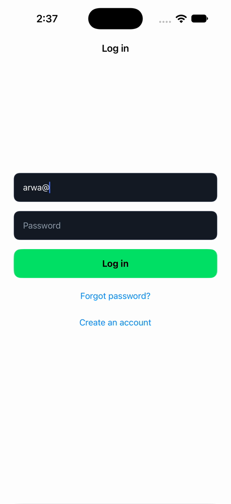
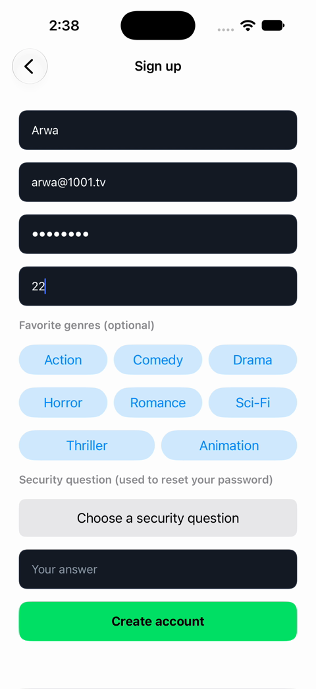
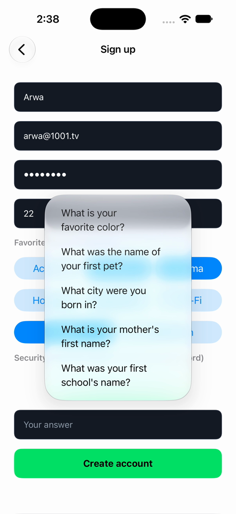
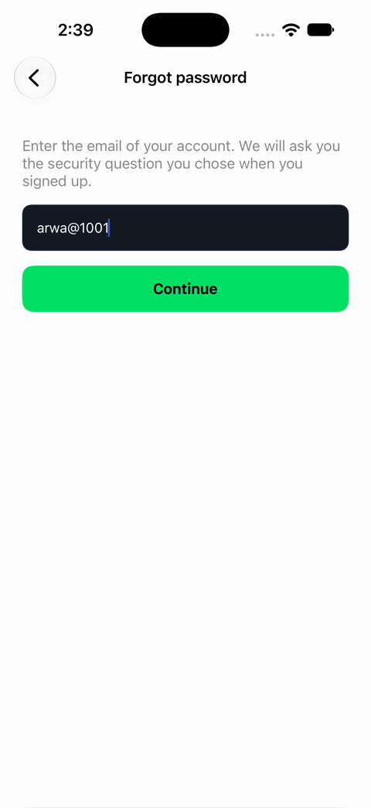
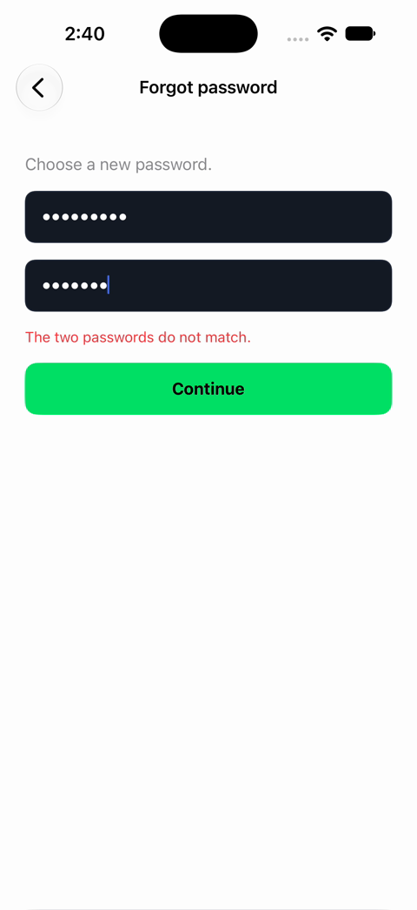

# Final Internship Report — 1001 (iOS Development Path)

**Intern:** Arwa Yaareb
**Role on the team:** iOS Developer (UI with UIKit)
**Teammates on the iOS path:** Bashar (QA) and Sarah (Backend)
**Mentor:** Amnah
**Company:** 1001 — Iraqi streaming platform (OTT)
**Program length:** 8 weeks
**Repository:** `1001tv/Interns-2026` — my work is in `The Interns/arwa-yaareb/` and `1001-interns/arwa-yaareb-ios-path/`

---

## Table of Contents

1. [Introduction](#1-introduction)
2. [Internship Objectives](#2-internship-objectives)
3. [Summary of Completed Tasks](#3-summary-of-completed-tasks)
4. [Skills and Technologies Learned](#4-skills-and-technologies-learned)
5. [Main Challenges and Solutions](#5-main-challenges-and-solutions)
6. [Important Achievements](#6-important-achievements)
7. [Lessons Learned](#7-lessons-learned)
8. [Future Improvement Areas](#8-future-improvement-areas)
9. [Conclusion](#9-conclusion)
10. [Appendix](#appendix)

---

## 1. Introduction

I am Arwa Yaareb, a senior Computer Science student at AUIB, and I graduate next semester. This semester I am carrying a heavy load: my final-year project, another remote job, and four other university courses, all alongside this internship. The internship at 1001 is a university requirement (every student completes two), and it is my **second** one.

I want to be honest about how I started. Before the program began, I wanted to quit. I joined expecting to learn very little, because that is what happened in my previous internship, an on-site placement at an Iraqi e-payment company. There I learned only how POS terminals work, how a transaction moves through the system, and how to set up IT infrastructure using Azure. It was not the growth I needed. My mentor, Amnah, encouraged me to stay, and I am very glad I listened.

**1001 taught me a great deal.** What I saw from the first week was professionalism, real teamwork, and actual learning. The journey went like this:

- **Learning the platform.** I started by reviewing 1001 across web, iPhone, iPad and Smart TV, and wrote a multi-platform review.
- **Version control.** I then worked through the full Git and GitHub workflow: branches, commits, pull requests and peer review.
- **A no-code Android app.** I built an Android app (AIExamGen) using the no-code MIT App Inventor tool.
- **A new path.** Amnah then changed the path for three of us — Sarah, Bashar and me — to **iOS development**. She had seen how well the three of us performed, and that is why we were given a separate path. I took the **UI with UIKit** role, Bashar took **QA**, and Sarah took the **backend**.

Having never written a line of Swift before, I learned the language and UIKit in a short time and delivered working authentication screens, secure session handling and a demo of our team's iOS mockup. I did that with the help of AI tools, but I also learned that tools are not enough: reading documentation and articles, not only watching videos, is what actually taught me to write code correctly.

The most important thing I take away is not a single technology. It is the **discipline, work ethic and professionalism** I experienced at 1001. I attended the daily stand-ups with my camera on, reported my updates in writing when I could not attend, attended the engineers' internal stand-up and the interns' tech talks every Thursday, and watched how a real engineering team communicates. It showed me what a professional company looks like, and it raised my own standard. I am very grateful to have been an intern here.

---

## 2. Internship Objectives

My objectives, set at the start and refined when the iOS path began, were:

1. **Understand the product.** Learn the 1001 platform and the OTT streaming industry well enough to build for it.
2. **Work like a professional team.** Learn version control, pull requests, tickets, stand-ups, and written reporting.
3. **Learn mobile development.** Start with Android (no-code), then move to native **iOS development with Swift and UIKit**.
4. **Build real features.** Deliver a working authentication module (Login, Sign Up, Forgot Password, secure session) for the team's iOS mockup, connected to the contract of the backend built by Sarah.
5. **Write clean, maintainable code.** Learn the principles of Clean Code, Clean Architecture and SOLID, and apply them.
6. **Grow professionally.** Build soft skills: communication, receiving feedback, and understanding how engineering, product and growth teams divide responsibilities.
7. **Prepare for a career.** Show that I can become a valuable future member of the 1001 iOS team.

---

## 3. Summary of Completed Tasks

### 3.1 Timeline overview

| Week | Focus | Main output |
|------|-------|-------------|
| 1 | Multi-platform review of 1001 | Cross-platform evaluation and bug report (web, iPhone, iPad, Smart TV) |
| 2 | Version control and first technical training | Task 01 (Git/GitHub workflow), PR, peer review, OTT architecture session |
| 3 | Android with no-code tooling | **AIExamGen** Android app (MIT App Inventor) |
| 4 | macOS environment and Swift basics | Working Xcode setup on university iMacs, first Swift study |
| 5 | Clean Code, Git troubleshooting, first UIKit project | `twoNavigationScreen` pushed to the repo |
| 6 | **[iOS][P0]** Swift and UIKit fundamentals (ticket #31) | Programmatic two-screen app with validation, README and video demo |
| 7–8 | **[iOS][P1]** Authentication UI and the MockUp project | Login, Sign Up, Forgot Password, Keychain session, AuthService, router |

### 3.2 Week 1 — Multi-platform review of 1001
- Tested 1001 on Desktop Web (Chrome), iPhone, iPad and Smart TV screen mirroring.
- Studied the platform's monetization model (AVOD vs SVOD) and analyzed UI elements such as the animated hero carousel, skeleton loading, and Arabic/English switching.
- Logged functional bugs, including SMS codes failing on web and iPad, a burger menu that opened from the wrong side, a live stream freezing when the iOS share sheet is opened, and a stretched phone layout on iPad.
- Observed that Arabic search returns bilingual titles thanks to strong metadata.

### 3.3 Weeks 1–2 — Task 01: Version Control Workflow
- Cloned the repo, created a feature branch, committed, pushed and opened a pull request.
- Fixed a VS Code authentication problem (personal vs work GitHub account).
- Peer-reviewed colleagues' pull requests and **helped a teammate from scratch** install Git, clone the repo and run the full workflow.
- Attended the first technical training session on OTT architecture: SVOD vs AVOD, B2B vs D2C, DRM, growth analytics and event tracking, staging vs production, and Agile/sprints with Jira.

### 3.4 Week 3 — Task 02: AIExamGen Android app (MIT App Inventor)
- Chose a design from the Figma Community and built a three-screen app: splash, login/registration, and home dashboard.
- Implemented a 150 ms `Clock`-based splash and authentication backed by `TinyDB`, with validation messages for unregistered users, wrong passwords and successful registration.
- Tested on a borrowed physical Android phone using the AI2 Companion app and delivered an `.apk`.
- Spent time researching Kotlin environment setup to prepare for native Android work.
- Audited how to tell a native app from a cross-platform one by its UI behavior.

### 3.5 Week 4 — Building a macOS development environment
- Tested several ways to run macOS on Windows hardware (VirtualBox, VMware, and an external-SSD QEMU setup tried together with Bashar).
- Moved to the university iMacs at American Spaces and worked with university IT over three days to get administrator access, update the OS and configure Xcode and command-line tools.
- Opened and ran my first iOS projects in Xcode and began studying Swift syntax.
- Attended Dawood's tech talk on career transitions, high-impact workplace habits, and backend engineering fundamentals.

### 3.6 Week 5 — Clean Code, Git troubleshooting and `twoNavigationScreen`
- Read the introduction to *Clean Code* by Robert C. Martin and its core thesis: "the only way to move fast is to keep the code clean."
- Attended the tech talk on Clean Architecture, GitHub Projects backlog management and SOLID.
- Organized and pushed the Xcode project to branch `interns/arwa-yaareb/ios-path-p0`, after solving several Git problems (see Section 5).

### 3.7 Week 6 — [iOS][P0] Swift and UIKit fundamentals (ticket #31)
- Built a **fully programmatic** (no storyboard) two-screen UIKit app: a profile form and a summary screen.
- Used `UIStackView`, Auto Layout constraints, `UINavigationController` configured in `SceneDelegate`, validation with `guard let`, and data passing through custom initializers.
- Verified the layout on several iPhone simulator sizes, wrote a README and recorded a video demo.

### 3.8 Weeks 7–8 — [iOS][P1] Authentication UI and the 1001 MockUp project
This was the largest piece of my work. I designed and built the authentication layer of the team's iOS mockup in `1001-interns/arwa-yaareb-ios-path/MockUpProject/`:

| Component | What it does |
|-----------|--------------|
| `LoadingVC` | Splash screen that is the app's root. It checks for a saved session, then routes the user. |
| `KeychainHelper` | Saves, reads and deletes the login token in the iOS **Keychain** (not `UserDefaults`), so the user stays logged in until logout. |
| `AuthService` | One service for `login`, `register`, `securityQuestion`, `verifySecurityAnswer`, `resetPassword` and `validateToken`, with typed `AuthError` cases (wrong credentials, unknown user, email exists, wrong answer, expired reset, rate limiting, network). A `useMock` switch lets the UI work before the backend was ready. |
| `AppRouter` | Swaps `window.rootViewController` with a cross-dissolve to show Login or Home, saves the token on login and deletes it on logout. |
| `LoginVC` | Email and password with validation, inline error messages, loading state, and links to Forgot Password and Sign Up. |
| `SignUpVC` | Name, email, password (minimum 8 characters), age, favorite-genre chips, and a security question with an answer. |
| `ForgotPasswordVC` | Three-step reset: email, then security question, then new password with confirmation (no OTP, as specified by the backend design). |
| `FormTextField`, `PrimaryButton`, `AppTheme` | Reusable components and a theme using the 1001 brand colors, so every screen shares the same look. |
| `RegistrationInfo`, `SignUpOptions` | Models for the sign-up data and its option lists. |

**App flow I implemented:** Loading → check Keychain for a token → validate the token with the server (valid → Home; rejected → delete token → Login; no connection → Login/retry) → Login / Sign Up / Forgot Password → main app.

I first drafted these screens as `AuthTextField`, `LoginViewController`, `SignUpViewController` and `ForgotPasswordViewController` (branch `interns/arwa-yaareb/ios-path-p1`) and then rebuilt them in the MockUp project on top of reusable components (`FormTextField`, `PrimaryButton`) and the shared theme.

### 3.9 Weekly rhythm and team participation
- **Daily stand-up, Sunday–Wednesday, 4:30 pm**, with my camera always on. When I could not attend, I posted my update in writing on the interns' Slack channel.
- **Thursday engineers' internal stand-up at 10:30** (I have classes Sunday–Wednesday, so Thursday was the day I could join). I attended even on an Iraqi public holiday so as not to miss anything.
- **Thursday interns' tech talks** — I attended every one.
- **Weekly reports** for each week, submitted through pull requests.

### 3.10 Contribution evidence from the repository
- 48 commits across 13 active days, from the first week to 13 October 2026.
- Pull requests merged by the mentor, including the weekly reports and the `ios-path-p0` project.
- Everything is in the repo under my own folders.

---

## 4. Skills and Technologies Learned

### 4.1 Technical skills

| Area | What I learned |
|------|----------------|
| **Swift** | Language fundamentals, optionals, `guard`/`if let`, enums as namespaces, `async/await`, `throws`, `Decodable`, `@MainActor`. |
| **UIKit** | Fully programmatic UI, Auto Layout (`NSLayoutConstraint`), `UIStackView`, `UINavigationController`, custom `UIView`/`UIButton`/`UITextField` subclasses, `UIAlertController`. |
| **App and view lifecycle** | Application states (not running, inactive, active, background, suspended); `viewDidLoad`, `viewWillAppear`, `viewDidAppear`, `viewWillDisappear`, `viewDidDisappear`; the different roles of `AppDelegate` and `SceneDelegate`. |
| **Security** | Why tokens belong in the Keychain and not `UserDefaults`; `SecItemAdd`, `SecItemCopyMatching`, `SecItemDelete`; token validation and handling `200`, `401` and offline cases. |
| **Networking and API contracts** | Integrating with a backend contract (login, register, security-question reset, token validation); status-code handling; mock-first development. |
| **Software design** | Clean Code, Clean Architecture (layer isolation, data flowing from the outer layer inward), SOLID, DRY through reusable components, separation of concerns (service / router / controller / model / theme). |
| **Git and GitHub** | Branching, commits, pull requests, peer review, `git pull --rebase`, removing a nested `.git` and a submodule gitlink, Personal Access Token authentication, GitHub Projects backlog. |
| **macOS and tooling** | Xcode, iOS simulators, command-line tools, `zsh` configuration (`vcs_info`), working on a Mac for the first time after years on Windows. |
| **Android (no-code)** | MIT App Inventor, `TinyDB`, layout arrangements, AI2 Companion, APK building, Figma-to-app design translation. |
| **QA awareness** | Writing bug reports with steps, app version and device model; acceptance criteria; the cost of a ticket rejected over a small mismatch. |

### 4.2 Industry and product knowledge
OTT streaming, AVOD vs SVOD, B2B vs D2C, ISP relationships, DRM, growth analytics and event tracking, staging vs production, weekly release cycles, Agile/sprints and Jira, tickets with acceptance criteria, KPIs, and code review.

### 4.3 Professional and soft skills
- Giving a clear daily update: *what I did yesterday, what I am doing today, what I will do next*.
- Taking feedback without defensiveness and applying it.
- Working across roles: UI with QA and backend, and communicating through API contracts.
- Time management under a heavy academic and work load.
- Handling imposter syndrome, interview preparation and LinkedIn presence, from the career sessions.
- Asking for help early, and helping others (I guided a teammate through Git from scratch).

---

## 5. Main Challenges and Solutions

| # | Challenge | Solution |
|---|-----------|----------|
| 1 | **No Mac for iOS development.** Virtual machines failed through driver incompatibility, blocked ISO downloads and failed VirtualBox/VMware setups. | Tried an external SSD with macOS and QEMU together with Bashar, who helped me a great deal. I then moved to the university iMacs and spent three days working with university IT to get administrator rights, an OS update and Xcode. |
| 2 | **Very limited iMac time** (two or three hours per session, on two days). | Prepared and tested Swift logic on my Windows laptop beforehand and used the lab hours only for Xcode builds and macOS-specific work. |
| 3 | **Never having coded in Swift.** | Studied the language through the official documentation and articles, practiced in small projects (`twoNavigationScreen`), and used AI as a tutor, always reading the code and documentation until I understood it. |
| 4 | **Xcode's hidden `.git` folder** made Git treat my project as a submodule. | Removed the nested `.git`, un-staged the cached gitlink with `git rm --cached`, and re-added the real files. |
| 5 | **GitHub rejected password login** and my push was rejected after the history diverged. | Authenticated with a Personal Access Token and used `git pull --rebase` to keep a linear history. (The token itself is never stored in the repo.) |
| 6 | **Terminal errors on macOS** (`precmd: command not found: vcs_info`). | Diagnosed `~/.zshrc` and corrected it to `autoload -Uz vcs_info`. |
| 7 | **Moving from storyboards to fully programmatic UI.** | Set up the window scene, navigation controller and root view controller in code (`SceneDelegate`), and later introduced `AppRouter` for root switching. |
| 8 | **Repeated code across auth screens** (text fields, buttons, colors). | Extracted `FormTextField`, `PrimaryButton` and `AppTheme` so every screen shares one implementation. |
| 9 | **Building the UI before the backend existed.** | Wrote `AuthService` against the agreed contract with a `useMock` switch and a mock account store, so Login, Sign Up and Forgot Password could be built and tested end to end. |
| 10 | **The demo did not look like the real 1001 platform.** Amnah pointed this out firmly. | I treated it as a design-review lesson: when the target is a specific product, fidelity to that product is the requirement. I took her notes on how the screens differ from the real platform as the list of work for the next iteration. The shared `AppTheme` and `PrimaryButton` components make that kind of restyling a change in one place. |
| 11 | **MIT App Inventor limits** (no padding, margins or rounded images; a login logic bug). | Used invisible arrangements as spacers and percentage sizing, pre-cropped images, and rebuilt the nested `if/else` blocks into isolated checks. |
| 12 | **Balancing the internship** with a final-year project, another job and four courses. | Fixed routines: stand-ups at set times, written updates when absent, and working in the lab on fixed days. |

---

## 6. Important Achievements

- **Went from zero Swift to a working native authentication module** in a few weeks, with Login, Sign Up, Forgot Password, Keychain-based session handling, token validation and error handling.
- **Selected for the iOS path.** Amnah moved Sarah, Bashar and me to a separate path because of how well we performed.
- **Solved the "no Mac" problem** through persistence and teamwork, and then worked consistently on the university iMac.
- **Delivered the iOS mockup demo** to the team and mentor and received detailed feedback on how to bring it closer to the real product.
- **Used a secure and scalable structure:** Keychain, a single service layer, a router, reusable components and a theme.
- **Contributed to the team:** helped a teammate set up Git from scratch and reviewed colleagues' pull requests.
- **Consistent attendance and communication:** daily stand-ups with the camera on, written updates when absent, the Thursday engineering stand-up (even on a public holiday), and every Thursday tech talk.
- **Consistent documentation:** weekly reports, task READMEs, a project README, screenshots and a video demo.
- **A shipped Android app** (AIExamGen, `.apk`) built under real tool limitations.

---

## 7. Lessons Learned

1. **Read the documentation, not just watch videos.** Videos are a good start, but articles and official documentation taught me the language, the workflow and the correct way to write code. This is the most important technical lesson of the internship.
2. **Engineers build what the product asks for.** Amnah explained that it is not engineering's job to add or remove features, because that is the work of the product and growth teams. A clear separation of roles, even in a startup, is what makes a team professional. It changed how I think about my role as a developer.
3. **Fidelity matters.** If the goal is to match an existing platform, the result must match it. "Close enough" is not a pass.
4. **Clean code is the fast way.** The only way to move fast is to keep the code clean. Reusable components and a single service layer saved me time every time the screens changed.
5. **Daily communication builds trust.** The *yesterday / today / next* stand-up format keeps everyone aligned and shows reliability. Even a short written update is better than silence.
6. **Security by default.** Tokens go in the Keychain, never in plain storage.
7. **Build against a contract.** Mocking the backend let the UI move forward while the backend was still being built, and made integration straightforward.
8. **Ask early, and help others.** Bashar's help with the Mac problem and my own help with Git showed me that teams move faster together.
9. **Use AI as a tutor, not as a substitute for understanding.** I used AI throughout, but I only count something as learned when I can explain every line.
10. **Discipline is a skill.** Showing up on time, with the camera on, every day, is what professionalism looks like.

---

## 8. Future Improvement Areas

**Technical**
- Switch `AuthService` from mock mode to the live backend and add integration tests with Bashar's QA test plan.
- Build the main app after login: tabs (Favorites, Home, Profile), movies by genre, favorites, Arabic/English and dark mode, logout.
- Make the UI **match the real 1001 app exactly**, as Amnah asked, with a full design-system pass.
- Add unit and UI tests (the test targets exist but are empty), and add accessibility support (VoiceOver labels, Dynamic Type).
- Improve error handling for poor connectivity, including a retry state.
- Learn SwiftUI, Combine and Swift concurrency in depth, and apply MVVM and fuller Clean Architecture.

**Professional**
- Keep working daily on the university iMac to build small apps and projects, learning iOS slowly and steadily.
- Study the 1001 iOS app as a user and as a developer.
- Improve my Git hygiene (smaller commits, clearer messages, a `.gitignore` for Xcode user data from the start).
- Keep reading documentation and engineering articles regularly.

**Career goal**
My aim is to join the 1001 iOS team, which is currently only one engineer, Ameer. I want to show, through consistent work and growth, that I can be a strong future employee.

---

## 9. Conclusion

I started this internship doubting that I would learn anything, and I finished it with new skills, new habits, and a clear career direction. In eight weeks I went from reviewing a streaming platform, to using Git professionally, to building an Android app, to writing native Swift and UIKit code for the team's iOS mockup.

I am also coming away with something that does not fit in a skills table: an understanding of how a professional engineering company works. The daily stand-ups, the "yesterday, today, next" updates, the clear role separation between engineering, product and growth, the weekly tech talks and the honest feedback all showed me the standard I want to work at. In my experience, 1001 is the only Iraqi company I have seen working at this level, and I have read about it as well (see the reference below).

Thank you to **Amnah**, my mentor, for her encouragement, her direct feedback and for opening the iOS path to me. Thank you to **Dawood** and **Ayah Salam** for their tech talks and guidance. Ayah also knew me from the SheCodesToo web development program in spring 2024, where she was a trainer. Thank you to my teammates **Bashar** and **Sarah**, especially Bashar for helping me through the Mac problem. And thank you to the whole 1001 engineering team for letting an intern sit in on their stand-ups.

The internship is ending, but my work is not. I will keep building and learning iOS, with the goal of coming back to 1001 as a member of the iOS team.

---

## Appendix

### A. Screenshots of the iOS mockup demo (13 October 2026)

Screens from the recorded team demo of the MockUp project, extracted from the video.

| Login | Sign up | Sign up: security question |
|-------|---------|----------------------------|
|  |  |  |

| Forgot password: email step | Forgot password: validation |
|-----------------------------|-----------------------------|
|  |  |

### B. Where to find my work in the repository

| Item | Location |
|------|----------|
| Task 01: Version control | `The Interns/arwa-yaareb/tasks/task-01-version-control/` |
| Task 02: AIExamGen Android app | `The Interns/arwa-yaareb/tasks/task-02-android-app/` |
| Weekly reports | `The Interns/arwa-yaareb/weekly-reports/` |
| iOS P0: `twoNavigationScreen` and Swift practice | `1001-interns/arwa-yaareb-ios-path/ios-p0/` |
| iOS P1: MockUp project (authentication) | `1001-interns/arwa-yaareb-ios-path/MockUpProject/` |
